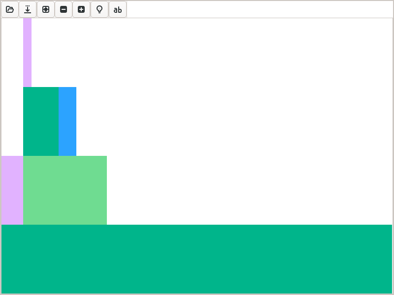

# Tutorial on `@snoop_inference`

Inference may occur when you *run* code. Inference is the first step of *type-specialized* compilation. `@snoop_inference` collects data on what inference is doing, giving you greater insight into what is being inferred and how long it takes.

Compilation is needed only for "fresh" code; running the demos below on code you've already used will yield misleading results. When analyzing inference, you're advised to always start from a fresh session. See also the [comparison between SnoopCompile and JET](@ref JET).

### Add SnoopCompileCore, SnoopCompile, and helper packages to your environment

Here, we'll add these packages to your [default environment](https://pkgdocs.julialang.org/v1/environments/). (With the exception of `AbstractTrees`, these "developer tool" packages should not be added to the Project file of any real packages unless you're extending the tool itself.)

```
using Pkg
Pkg.add(["SnoopCompileCore", "SnoopCompile", "AbstractTrees", "ProfileView"]);
```

## Setting up the demo

To see `@snoop_inference` in action, we'll use the following demo:

```jldoctest flatten-demo; filter=r"Main\.var\"Main\"\."
module FlattenDemo
    struct MyType{T} x::T end

    extract(y::MyType) = y.x

    function domath(x)
        y = x + x
        return y*x + 2*x + 5
    end

    dostuff(y) = domath(extract(y))

    function packintype(x)
        y = MyType{Int}(x)
        return dostuff(y)
    end
end

# output

Main.var"Main".FlattenDemo
```

The main call, `packintype`, stores the input in a `struct`, and then calls functions that extract the field value and performs arithmetic on the result.

## [Collecting the data](@id sccshow)

To profile inference on this call, do the following:

```jldoctest flatten-demo; filter=r"([0-9]*\.?[0-9]+([eE][-+]?[0-9]+)?|WARNING: replacing module FlattenDemo\.\n)"
julia> using SnoopCompileCore

julia> tinf = @snoop_inference FlattenDemo.packintype(1);

julia> using SnoopCompile

julia> tinf
InferenceTimingNode: 0.000007/0.005233 on Base.Compiler.Timings.ROOT() with 1 direct children
```

!!! tip
    Don't omit the semicolon on the `tinf = @snoop_inference ...` line, or you may get an enormous amount of output. The compact display on the final line is possible only because `SnoopCompile` defines nice `Base.show` methods for the data returned by `@snoop_inference`. These methods cannot be defined in `SnoopCompileCore` because it has a fundamental design constraint: loading `SnoopCompileCore` is not allowed to invalidate any code. Moving those `Base.show` methods to `SnoopCompileCore` would violate that guarantee.

This may not look like much, but there's a wealth of information hidden inside `tinf`.

## A quick check for potential invalidations

After running `@snoop_inference`, it's generally recommended to check the output of [`staleinstances`](@ref):
```julia
julia> staleinstances(tinf)
SnoopCompileCore.InferenceTiming[]
```

If you see this, all's well.
A non-empty list might indicate method invalidations, which can be checked (in a fresh session) using the tools described in [Tutorial on `@snoop_invalidations`](@ref).

If you do have a lot of invalidations, [`precompile_blockers`](@ref) may be an effective way to reveal those invalidations that affect your particular package and workload.

## [Viewing the results](@id flamegraph)

Let's start unpacking the output of `@snoop_inference` and see how to get more insight.
First, notice that the output is an `InferenceTimingNode`: it's the root element of a tree of such nodes, all connected by caller-callee relationships.
Indeed, this particular node is for `Base.Compiler.Timings.ROOT()`, a "dummy" node that is the root of all such trees.

You may have noticed that this `ROOT` node prints with two numbers.
It will be easier to understand their meaning if we first display the whole tree.
We can do that with the [AbstractTrees](https://github.com/JuliaCollections/AbstractTrees.jl) package:

```jldoctest flatten-demo; filter=[r"[0-9]*\.?[0-9]+([eE][-+]?[0-9]+)?", r"Main\.var\"Main\"\."]
julia> using AbstractTrees

julia> print_tree(tinf, maxdepth=100)
InferenceTimingNode: 0.000007/0.005233 on Base.Compiler.Timings.ROOT() with 1 direct children
└─ InferenceTimingNode: 0.004478/0.005226 on Main.var"Main".FlattenDemo.packintype(::Int64) with 2 direct children
   ├─ InferenceTimingNode: 0.000205/0.000205 on Main.var"Main".FlattenDemo.MyType{Int64}(::Int64) with 0 direct children
   └─ InferenceTimingNode: 0.000200/0.000544 on Main.var"Main".FlattenDemo.dostuff(::Main.var"Main".FlattenDemo.MyType{Int64}) with 2 direct children
      ├─ InferenceTimingNode: 0.000183/0.000228 on Main.var"Main".FlattenDemo.extract(::Main.var"Main".FlattenDemo.MyType{Int64}) with 1 direct children
      │  └─ InferenceTimingNode: 0.000045/0.000045 on getproperty(::Main.var"Main".FlattenDemo.MyType{Int64}, ::Symbol) with 0 direct children
      └─ InferenceTimingNode: 0.000115/0.000115 on Main.var"Main".FlattenDemo.domath(::Int64) with 0 direct children
```

This tree structure reveals the caller-callee relationships, showing the specific types that were used for each `MethodInstance`.
For example, `getproperty(::MyType{Int64}, ::Symbol)` corresponds to `y.x` in the definition of `extract`.

!!! note
    Generally we speak of [call graphs](https://en.wikipedia.org/wiki/Call_graph) rather than call trees.
    But because inference results are cached (a.k.a., we only "visit" each node once), we obtain a tree as a depth-first-search of the full call graph.

You can extract the `MethodInstance` with

```jldoctest flatten-demo
julia> Core.MethodInstance(tinf)
MethodInstance for Base.Compiler.Timings.ROOT()

julia> Core.MethodInstance(tinf.children[1])
MethodInstance for Main.var"Main".FlattenDemo.packintype(::Int64)
```

Each node in this tree is accompanied by a pair of numbers.
The first number is the *exclusive* inference time (in seconds), meaning the time spent inferring the particular `MethodInstance`, not including the time spent inferring its callees.
The second number is the *inclusive* time, which is the exclusive time plus the time spent on the callees.
Therefore, the inclusive time is always at least as large as the exclusive time.

The `ROOT` node is a bit different: it is a placeholder for the top of the tree, not a function that was inferred, so its exclusive time is negligible.
Its inclusive time is the total for all the compilation recorded by `@snoop_inference`.

By default, both numbers also include the time LLVM spent generating native code for the `MethodInstance`;
pass `include_llvm=false` to [`exclusive`](@ref) and [`inclusive`](@ref) to obtain the time for type-inference alone.
In this demo, only `packintype` was compiled to native code (its callees were inlined into it),
and native code generation accounts for most of its exclusive time.
As you will quickly discover, inference takes much more time on more complicated code.

We can also display this tree as a flame graph, using the [ProfileView.jl](https://github.com/timholy/ProfileView.jl) package:

```jldoctest flatten-demo; filter=r":\d+"
julia> fg = flamegraph(tinf)
Node(FlameGraphs.NodeData(ROOT() at typeinfer.jl:75, 0x00, 0:10080857))
```

```julia
julia> using ProfileView

julia> ProfileView.view(fg)
```

You should see something like this:



Users are encouraged to read the ProfileView documentation to understand how to interpret this, but briefly:

- the horizontal axis is time (wide boxes take longer than narrow ones), the vertical axis is call depth
- hovering over a box displays the method that was inferred
- left-clicking on a box causes the full `MethodInstance` to be printed in your REPL session
- right-clicking on a box opens the corresponding method in your editor
- ctrl-click can be used to zoom in
- empty horizontal space above a box corresponds to that box's exclusive time, the time not spent on its callees
- any boxes colored red (there are none in this particular example, but you'll see some later) correspond to *naively non-precompilable* `MethodInstance`s, in which the method is owned by one module but the types are from another unrelated module. Such `MethodInstance`s are omitted from the precompile cache file unless they've been "marked" by `PrecompileTools.@compile_workload` or an explicit `precompile` directive. See [`SnoopCompile.isprecompilable`](@ref) for further explanation and some examples.

You can explore this flamegraph and compare it to the output from `print_tree`.

!!! note
    Julia 1.12 and later do not record inference for specific constant values ([constant propagation](https://en.wikipedia.org/wiki/Constant_folding)) as separate frames, so it cannot be identified in the tree or the flamegraph. It can still affect TTFX, and may cause compilation of something that you thought you had precompiled. For example, suppose your workload "exercises" `myfun(args...; warn=true)`, so you might think you have `myfun` covered for the corresponding argument *types*. But constant-propagation results in (re)compilation for specific *values*: if Julia has decided that `myfun` merits constant-propagation, a call `myfun(args...; warn=false)` might need to be compiled separately.

    When you want to prevent constant-propagation from hurting your TTFX, you have two options:
    - precompile for all relevant argument *values* as well as types. The most common argument types to trigger Julia's constprop heuristics are numbers (`Bool`/`Int`/etc) and `Symbol`.
    - Disable constant-propagation for this method by adding `Base.@constprop :none` in front of your definition of `myfun`. Constant-propagation can be a big performance boost when it changes how performance-sensitive code is optimized for specific input values, but when this doesn't apply you can safely disable it.

Finally, [`flatten`](@ref), on its own or together with [`accumulate_by_source`](@ref), allows you to get an sense for the cost of individual `MethodInstance`s or `Method`s.

The tools here allow you to get an overview of where inference is spending its time.
This gives you insight into the major contributors to latency.
