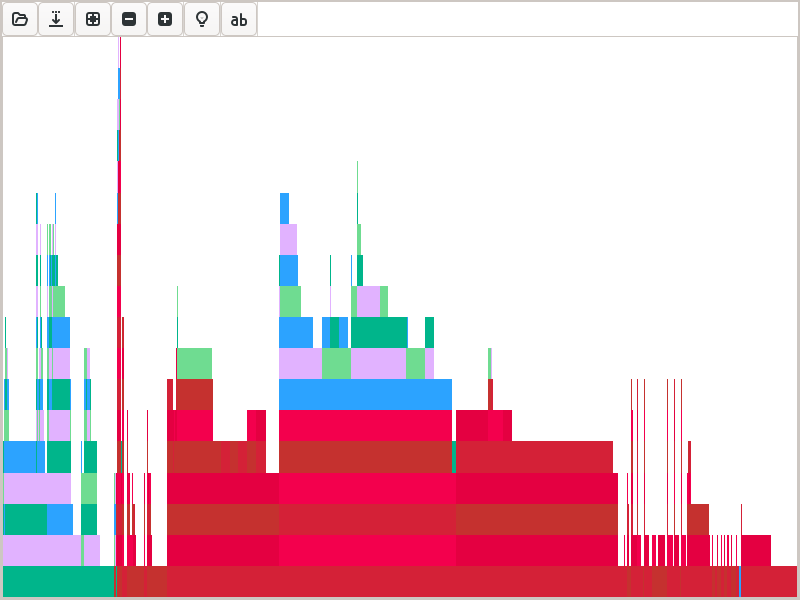
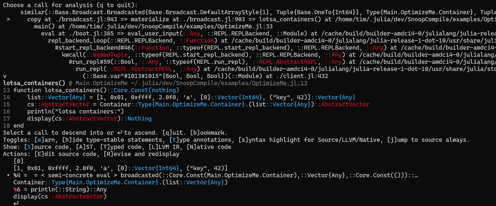

# [Using `@snoop_inference` results to improve inferrability](@id inferrability)

Throughout this page, we'll use the `OptimizeMe` demo, which ships with `SnoopCompile`.

!!! note
    To understand what follows, it's essential to refer to [`OptimizeMe` source code](https://github.com/timholy/SnoopCompile.jl/blob/master/examples/OptimizeMe.jl) as you follow along.

```@repl fix-inference
using SnoopCompileCore, SnoopCompile # here we need the SnoopCompile path for the next line (normally you should wait until after data collection is complete)
include(joinpath(pkgdir(SnoopCompile), "examples", "OptimizeMe.jl"))
tinf = @snoop_inference OptimizeMe.main();
fg = flamegraph(tinf)
```

If you visualize `fg` with ProfileView, you may see something like this:



From the standpoint of precompilation, this has some obvious problems:

- even though we called a single method, `OptimizeMe.main()`, the bottom row consists of many boxes, each the base of a distinct flame. This indicates that many calls are being made by runtime dispatch:  each separate flame is a fresh entrance into inference.
- several of the flames are marked in red, indicating that they are not naively precompilable (see the [Tutorial on `@snoop_inference`](@ref)). While `@compile_workload` can handle these flames, an even more robust solution is to eliminate them altogether.

Our goal will be to improve the design of `OptimizeMe` to make it more readily precompilable.

## Analyzing inference triggers

We'll first extract the "triggers" of inference, which is just a repackaging of part of the information contained within `tinf`.
Specifically an [`InferenceTrigger`](@ref) captures callee/caller relationships that straddle a fresh entrance to type-inference, allowing you to identify which calls were made by runtime dispatch and what `MethodInstance` they called.

```@repl fix-inference
itrigs = inference_triggers(tinf)
```

The number of elements in this `Vector{InferenceTrigger}` tells you how many calls were (1) made by runtime dispatch and (2) the callee had not previously been inferred.

!!! tip
    In the REPL, `SnoopCompile` displays `InferenceTrigger`s with yellow coloration for the callee, red for the caller method, and blue for the caller specialization. This makes it easier to quickly identify the most important information.

In some cases, this might indicate that you'll need to fix each case separately; fortunately, in many cases fixing one problem addresses many other.

### [Method triggers](@id methtrigs)

Most often, it's most convenient to organize them by the method triggering the need for inference:

```@repl fix-inference
mtrigs = accumulate_by_source(Method, itrigs)
```

The methods triggering the largest number of inference runs are shown at the bottom.
You can also select methods from a particular module:

```@repl fix-inference
modtrigs = filtermod(OptimizeMe, mtrigs)
```

Rather than filter by a single module, you can alternatively call `SnoopCompile.parcel(mtrigs)` to split them out by module.
In this case, most of the triggers came from `Base`, not `OptimizeMe`.
However, many of the failures in `Base` were nevertheless indirectly due to `OptimizeMe`: our methods in `OptimizeMe` call `Base` methods with arguments that trigger internal inference failures.
Fortunately, we'll see that using more careful design in `OptimizeMe` can avoid many of those problems.

!!! tip
    If you have a longer list of inference triggers than you feel comfortable tackling, filtering by your package's module or using [`precompile_blockers`](@ref) can be a good way to start.
    Fixing issues in the package itself can end up resolving many of the "indirect" triggers too.
    Also be sure to note the ability to filter out likely "noise" from [test suites](@ref test-suites).

You can get an overview of each Method trigger with `summary`:

```@repl fix-inference
mtrig = modtrigs[1]
summary(mtrig)
```

You can also say `edit(mtrig)` and be taken directly to the method you're analyzing in your editor.
You can still "dig deep" into individual triggers:

```@repl fix-inference
itrig = mtrig.itrigs[1]
```

This is useful if you want to analyze with `Cthulhu.ascend`.
`Method`-based triggers, which may aggregate many different individual triggers, can be useful because tools like [Cthulhu.jl](https://github.com/JuliaDebug/Cthulhu.jl) show you the inference results for the entire `MethodInstance`, allowing you to fix many different inference problems at once.

### Trigger trees

While method triggers are probably the most useful way of organizing these inference triggers, for learning purposes here we'll use a more detailed scheme, which organizes inference triggers in a tree:

```@repl fix-inference
itree = trigger_tree(itrigs)
using AbstractTrees
print_tree(itree)
```

This gives you a big-picture overview of how the inference failures arose.
The parent-child relationships are based on the backtraces at the entrance to inference,
and the nodes are organized in the order in which inference occurred.
Inspection of these trees can be informative; for example, here we notice a lot of method specializations for `Container{T}` for different `T`.

We're going to march through these systematically.

### `suggest` and fixing `Core.Box`

You may have noticed above that `summary(mtrig)` generated a red `has Core.Box` message. Assuming that `itrig` is still the first (and it turns out, only) trigger from this method, let's look at this again, explicitly using [`suggest`](@ref), the tool that generated this hint:

```@repl fix-inference
suggest(itrig)
```

You can see that SnoopCompile recommends tackling this first; depending on how much additional code is affected, fixing a  `Core.Box` allows inference to work better and may resolve other triggers.

This message also directs readers to a section of [this documentation](@ref Fixing-Core.Box) that links to a page of the Julia manual describing the underlying problem. The Julia documentation suggests a couple of fixes, of which the best (in this case) is to use the `let` statement to rebind the variable and end any "conflict" with the closure:

```
function abmult(r::Int, ys)
    if r < 0
        r = -r
    end
    let r = r    # Julia #15276
        return map(x -> howbig(r * x), ys)
    end
end
```


### `suggest` and a fix involving manual `eltype` specification

Let's look at the other Method-trigger rooted in `OptimizeMe`:

```@repl fix-inference
mtrig = modtrigs[2]
summary(mtrig)
itrig = mtrig.itrigs[1]
```

If you use Cthulhu's `ascend(itrig)` you might see something like this:



The first thing to note here is that `cs` is inferred as an `AbstractVector`--fixing this to make it a concrete type should be our next goal. There's a second, more subtle hint: in the call menu at the bottom, the selected call is marked `< semi-concrete eval >`. This is a hint that a method is being called with a non-concrete type.

What might that non-concrete type be?

```@repl fix-inference
isconcretetype(OptimizeMe.Container)
```

The statement `Container.(list)` is thus creating an `AbstractVector` with a non-concrete element type.
You can seem in greater detail what happens, inference-wise, in this snippet from `print_tree(itree)`:

```
   ├─ similar(::Base.Broadcast.Broadcasted{Base.Broadcast.DefaultArrayStyle{1}, Tuple{Base.OneTo{Int64}}, Type{Main.OptimizeMe.Container}, Tuple{Base.Broadcast.Extruded{Vector{Any}, Tuple{Bool}, Tuple{Int64}}}}, ::Type{Main.OptimizeMe.Container{Int64}})
   ├─ setindex!(::Vector{Main.OptimizeMe.Container{Int64}}, ::Main.OptimizeMe.Container{Int64}, ::Int64)
   ├─ Base.Broadcast.copyto_nonleaf!(::Vector{Main.OptimizeMe.Container{Int64}}, ::Base.Broadcast.Broadcasted{Base.Broadcast.DefaultArrayStyle{1}, Tuple{Base.OneTo{Int64}}, Type{Main.OptimizeMe.Container}, Tuple{Base.Broadcast.Extruded{Vector{Any}, Tuple{Bool}, Tuple{Int64}}}}, ::Base.OneTo{Int64}, ::Int64, ::Int64)
   │  ├─ similar(::Base.Broadcast.Broadcasted{Base.Broadcast.DefaultArrayStyle{1}, Tuple{Base.OneTo{Int64}}, Type{Main.OptimizeMe.Container}, Tuple{Base.Broadcast.Extruded{Vector{Any}, Tuple{Bool}, Tuple{Int64}}}}, ::Type{Main.OptimizeMe.Container})
   │  └─ Base.Broadcast.restart_copyto_nonleaf!(::Vector{Main.OptimizeMe.Container}, ::Vector{Main.OptimizeMe.Container{Int64}}, ::Base.Broadcast.Broadcasted
```

In rough terms, what this means is the following:
- since the first item in `list` is an `Int`, the output initially gets created as a `Vector{Container{Int}}`
- however, `copyto_nonleaf!` runs into trouble when it goes to copy the second item, which is a `Container{UInt8}`
- hence, `copyto_nonleaf!` re-allocates the output array to be a generic `Vector{Container}` and then calls `restart_copyto_nonleaf!`.

We can prevent all this hassle with one simple change: rewrite that line as

```
cs = Container{Any}.(list)
```

We use `Container{Any}` here because there is no more specific element type--other than an unreasonably-large `Union`--that can hold all the items in `list`.

If you make these edits manually, you'll see that we've gone from dozens of `itrigs` (38 on Julia 1.10, you may get a different number on other Julia versions) down to about a dozen (13 on Julia 1.10). Real progress!

### Replacing hard-to-infer calls with lower-level APIs

We note that many of the remaining triggers are somehow related to `show`, for example:

```
Inference triggered to call show(::IOContext{Base.TTY}, ::MIME{Symbol("text/plain")}, ::Vector{Main.OptimizeMe.Container{Any}}) from #55 (/cache/build/builder-amdci4-0/julialang/julia-release-1-dot-10/usr/share/julia/stdlib/v1.10/REPL/src/REPL.jl:273) with specialization (::REPL.var"#55#56"{REPL.REPLDisplay{REPL.LineEditREPL}, MIME{Symbol("text/plain")}, Base.RefValue{Any}})(::Any)
```

In this case we see that the calling method is `#55`.  This is a `gensym`, or generated symbol, indicating that the method was generated during Julia's lowering pass, and might indicate a macro, a `do` block or other anonymous function, the generator for a `@generated` function, etc.

`edit(itrig)` (or equivalently, `edit(node)` where `node` is a child of `itree`) takes us to this method in `Base`, for which key lines are

```julia
function display(d::REPLDisplay, mime::MIME"text/plain", x)
    x = Ref{Any}(x)
    with_repl_linfo(d.repl) do io
        ⋮
        show(io, mime, x[])
        ⋮
end
```

The generated method corresponds to the `do` block here.
The call to `show` comes from `show(io, mime, x[])`.
This implementation uses a clever trick, wrapping `x` in a `Ref{Any}(x)`, to prevent specialization of the method defined by the `do` block on the specific type of `x`.
This trick is designed to limit the number of `MethodInstance`s inferred for this `display` method.

A great option is to replace the call to `display` with an explicit

```
show(stdout, MIME("text/plain"), cs)
```

There's one extra detail: the type of `stdout` is not fixed (and therefore not known), because one can use a terminal, a file, `devnull`, etc., as `stdout`. If you want to prevent all runtime dispatch from this call, you'd need to supply an `io::IO` object of known type as the first argument. It could, for example, be passed in to `lotsa_containers` from `main`:

```
function lotsa_containers(io::IO)
    ⋮
    println(io, "lotsa containers:")
    show(io, MIME("text/plain"), cs)
end
```

However, if you want it to go to `stdout`--and to allow users to redirect `stdout` to a target of their choosing--then an `io` argument may have to be of unknown type when called from `main`.

### When you need to rely on `@compile_workload`

Most of the remaining triggers are difficult to fix because they occur in deliberately-`@nospecialize`d portions of Julia's internal code for displaying arrays. In such cases, adding a `PrecompileTools.@compile_workload` is your best option. Here we use an interesting trick:

```
@compile_workload begin
    lotsa_containers(devnull)  # use `devnull` to suppress output
    abmult(rand(-5:5), rand(3))
end
precompile(lotsa_containers, (Base.TTY,))
```

During the workload, we pass `devnull` as the `io` object to `lotsa_containers`: this suppresses the output so you don't see anything during precompilation. However, `devnull` is not a `Base.TTY`, the standard type of `stdout`. Nevertheless, this is effective because we can see that many of the callees in the remaining inference-triggers do not depend on the `io` object.

To really ice the cake, we also add a manual `precompile` directive. (`precompile` doesn't execute the method, it just compiles it.) This doesn't "step through" runtime dispatch, but at least it precompiles the entry point.
Thus, at least `lotsa_containers` will be precompiled for the most likely `IO` type encountered in practice.

With these changes, we've fixed nearly all the latency problems in `OptimizeMe`, and made it much less vulnerable to invalidation as well. You can see the final code in the [`OptimizeMeFixed` source code](https://github.com/timholy/SnoopCompile.jl/blob/master/examples/OptimizeMeFixed.jl). Note that this would have to be turned into a real package for the `@compile_workload` to have any effect.

## [A note on analyzing test suites](@id test-suites)

If you're doing a package analysis, it's convenient to use the package's `runtests.jl` script as a way to cover much of the package's functionality.
SnoopCompile has a couple of enhancements designed to make it easier to ignore inference triggers that come from the test suite itself.
First, `suggest.(itrigs)` may show something like this:

```
 ./broadcast.jl:1315: inlineable (ignore this one)
 ./broadcast.jl:1315: inlineable (ignore this one)
 ./broadcast.jl:1315: inlineable (ignore this one)
 ./broadcast.jl:1315: inlineable (ignore this one)
```

This indicates a broadcasting operation in the `@testset` itself.
Second, while it's a little dangerous (because `suggest` cannot entirely be trusted), you can filter these out:

```julia
julia> itrigsel = [itrig for itrig in itrigs if !isignorable(suggest(itrig))];

julia> length(itrigs)
222

julia> length(itrigsel)
71
```

While there is some risk of discarding triggers that provide clues about the origin of other triggers (e.g., they would have shown up in the same branch of the `trigger_tree`), the shorter list may help direct your attention to the "real" issues.
